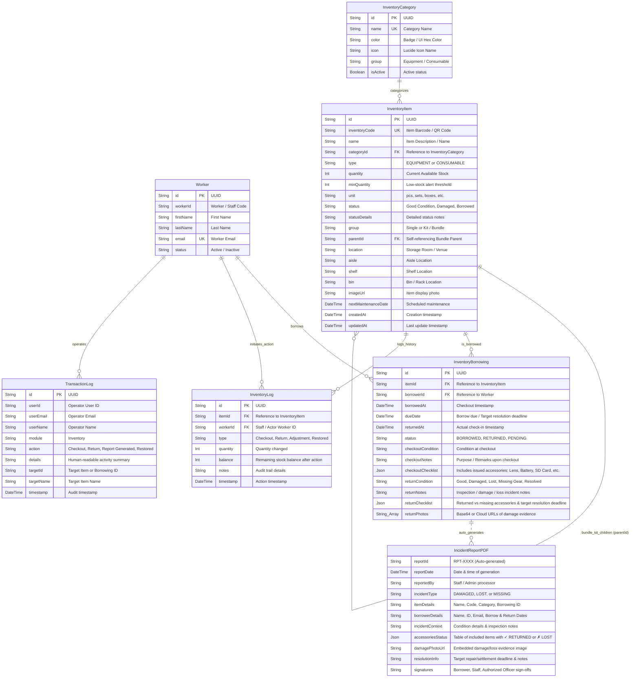

# 📊 Pinakabagong Entity-Relationship Diagram (ERD)
### Inventory Management, Equipment Checkout/Return, Damaged/Lost Tracking & Incident PDF Report

---

## 1. Visual ERD Diagram

---

## 2. Talaan ng mga Bagong Attribute at Halaga

### A. `InventoryBorrowing` (Check-in, Damage & Loss Tracking)
| Column / Field | Data Type | Layunin / Gamit sa Bagong Feature |
| :--- | :--- | :--- |
| `status` | `String` | Pinalawak upang suportahan ang **`PENDING`** para sa mga item na naibalik na sira (Damaged), nawawala (Lost), o kulang ang accessories. Nanatiling `BORROWED` habang gamit, at nagiging `RETURNED` kapag Good Condition o Resolved na. |
| `checkoutChecklist` | `Json` | Naglalaman ng `includedEquipment: string[]` (hal. Lens, Battery, SD Card, Tripod, Bag). |
| `returnCondition` | `String` | Nagtatala kung `Good Condition`, `Minor Wear`, `Damaged`, `Lost`, o `Resolved`. |
| `returnChecklist` | `Json` | Nagtatala ng status ng bawat accessory (`returnedInclusions: { [gear]: boolean }`), mga nawawala (`missingItems: string[]`), at ang napagkasunduang deadline (`resolutionDeadline`). |
| `returnPhotos` | `String[]` | Array ng mga base64 o cloud URL ng kuha ng camera o inupload na ebidensya ng sira. |
| `dueDate` | `DateTime` | Bukod sa orihinal na return due date, ginagamit din bilang **Target Resolution / Replacement Deadline** kapag pending resolution. |

### B. `InventoryItem` (Stock Protection para sa Damaged / Lost)
| Column / Field | Data Type | Layunin / Gamit sa Bagong Feature |
| :--- | :--- | :--- |
| `status` | `String` | Automatic na minamarkahan bilang `Damaged` o `Lost`. Hindi ibinabalik sa available stock ang item kung ito ay reported na nawala o sira hangga't hindi pa nare-resolve. |
| `quantity` | `Int` | Ang bilang ng stock na pwedeng hiramin. Nababawasan sa Checkout, ibinabalik sa Return (kung good condition), at nire-restore lamang kapag minarkahang *Resolved / Repaired / Replaced*. |
| `parentId` / `children` | `Self-relation` | Para sa mga **Kit / Bundles** (hal. Camera Drone na may kasamang drone body, controller, extra props, at hard case). |

### C. `IncidentReportPDF` (Export Data Structure)
| Component | Functionality |
| :--- | :--- |
| **Header Strip** | Nagtataglay ng Church Name, Report ID (`RPT-XXXXXXXX`), Type Badge, at Creation Date sa Dark Navy Blue (`#1c4184`). |
| **Equipment & Borrower Details** | 2-Column summary ng gamit at ng taong humiram. |
| **Incident Details** | Reason, inspection notes, at pangalan ng admin/staff na tumanggap. |
| **Accessories Checklist** | Auto-table ng lahat ng inisyu na gamit na may kulay na tag (**✓ RETURNED** o **✗ LOST / MISSING**). |
| **Damage Photo** | Direktang naka-embed ang uploaded camera evidence sa loob ng PDF. |
| **Resolution & Signatures** | Deadline ng pag-aayos o pagpapalit at 3 signature blocks (Borrower, Inventory Staff, Authorized Approver). |

